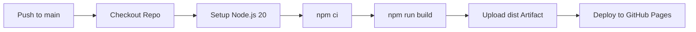

<div align="center">

  <h1>Harshith Medichelme</h1>
  <p><strong>Personal Engineering Portfolio & Interactive Showcase</strong></p>

  <p>
    <a href="https://harshith397.github.io"><strong>Explore Live Site »</strong></a>
  </p>

  [](https://react.dev/)
  [](https://vitejs.dev/)
  [](https://tailwindcss.com/)
  [](https://threejs.org/)
  [](https://www.framer.com/motion/)
  [](https://github.com/harshith397/harshith397.github.io/actions/workflows/deploy.yml)

</div>

---

## ✦ Overview

This repository houses the source code for my personal developer portfolio, live at **[harshith397.github.io](https://harshith397.github.io)**. 

Built with a focus on tactile micro-interactions, clean Apple HIG-inspired typography, and performance-first 3D visuals, it acts as an engineering lab showcasing full-stack applications, mobile systems, and creative web experiments.

---

## ✦ Key Features

### 1. 🖨️ Interactive Vintage Typewriter Resume
- **Tactile Sound & Feel:** Simulates a mechanical typewriter with physical carriage returns, keystroke acoustics, and paper slide transitions.
- **Live PDF Rendering:** Uses **PDF.js** to dynamically render and preview resume sheets directly on an HTML5 canvas without external plugins.
- **Instant Export:** One-click download with authentic carriage return sounds.

### 2. 🪐 3D Minimalist Orbital Skills Galaxy
- **Interactive 3D Scene:** Powered by **Three.js** and **GSAP**, featuring an Apple-inspired glass central sphere with specular refraction.
- **Orbiting Planetary Nodes:** Technological proficiencies float around the category sphere with real-time collision offsets, dynamic camera zooms, and category switching.
- **2D Graceful Fallback:** Accessible alternative view for low-power mobile devices and non-WebGL environments.

### 3. 🛠️ Engineering Deep-Dive Case Studies
- Structured project breakdowns highlighting real-world engineering trade-offs (e.g., bypassing ERP Cloudflare/reCAPTCHA using on-device WebView bridges, automated PDF scraping pipelines using Groq vision models).
- Interactive media previews, architecture highlights, and problem-solution journals.

### 4. ⚡ Modern Motion & Polish
- **Lenis Smooth Scroll:** Butter-smooth 60fps momentum scroll.
- **Tailwind CSS v4:** Zero-runtime overhead stylesheet with modern OKLCH color palettes and glassmorphism utilities.
- **Framer Motion:** Cohesive entrance transitions and spring-based interactions.

---

## ✦ Tech Stack

| Category | Technologies |
|---|---|
| **Core Framework** | [React 19](https://react.dev/), [Vite 7](https://vitejs.dev/), [React Router v7](https://reactrouter.com/) |
| **Styling & Design** | [Tailwind CSS v4](https://tailwindcss.com/), Custom Glassmorphic Theme |
| **3D & Canvas** | [Three.js](https://threejs.org/), [PDF.js](https://mozilla.github.io/pdf.js/) |
| **Motion & Sound** | [Framer Motion](https://www.framer.com/motion/), [GSAP](https://gsap.com/), [Lenis](https://lenis.darkroom.engineering/), Web Audio API |
| **Icons & Assets** | [Lucide React](https://lucide.dev/), [Heroicons](https://heroicons.com/), [Simple Icons](https://simpleicons.org/) |
| **CI/CD & Hosting** | [GitHub Actions](https://github.com/features/actions), [GitHub Pages](https://pages.github.com/) |

---

## ✦ Project Structure

```text
├── .github/
│   └── workflows/
│       └── deploy.yml          # Automated CI/CD pipeline for GitHub Pages
├── public/                     # Static assets, images, preview screenshots & resume
├── src/
│   ├── components/
│   │   ├── OrbitalSkills3D/    # Three.js 3D skills galaxy implementation
│   │   ├── TypewriterResume.jsx# Vintage mechanical typewriter resume experience
│   │   ├── ProjectCard.jsx     # Project showcase cards
│   │   ├── ProjectTechGlobe.jsx# Tech globe visualizer
│   │   ├── Hero.jsx            # Dynamic hero section with greetings
│   │   ├── AboutMe.jsx         # Personal narrative and background
│   │   ├── Skills.jsx          # Skills container with 3D/2D views
│   │   ├── Projects.jsx        # Featured engineering projects
│   │   └── Connect.jsx         # Social contacts & inquiry section
│   ├── data/
│   │   ├── projects_data.json  # Comprehensive project case studies & journals
│   │   ├── orbitalSkillsData.js# 3D Skills categories and technical nodes
│   │   ├── hero.json           # Hero copy and dynamic greetings
│   │   └── about.json          # Story paragraphs and keyword pills
│   ├── pages/
│   │   ├── Home.jsx            # Main landing page
│   │   ├── ProjectPage.jsx     # Standalone case study deep-dive
│   │   └── AllProjects.jsx     # Full project archive
│   ├── App.jsx                 # Routes & smooth scrolling setup
│   └── main.jsx                # Application root
└── package.json
```

---

## ✦ Getting Started Locally

### Prerequisites
- **Node.js** (v18 or higher recommended)
- **npm** (v9 or higher)

### Setup Instructions

1. **Clone the repository:**
   ```bash
   git clone https://github.com/harshith397/harshith397.github.io.git
   cd harshith397.github.io
   ```

2. **Install dependencies:**
   ```bash
   npm install
   ```

3. **Start the local development server:**
   ```bash
   npm run dev
   ```
   Open [http://localhost:5173](http://localhost:5173) in your browser.

4. **Build for production:**
   ```bash
   npm run build
   ```
   The production-ready assets will be generated in the `dist/` directory.

---

## ✦ CI/CD Pipeline

The portfolio is deployed automatically via **GitHub Actions** (`.github/workflows/deploy.yml`):



Every push to the `main` branch triggers an automated build and deploy to GitHub Pages without requiring any manual deployment steps.

---

## ✦ Connect With Me

- **Portfolio:** [harshith397.github.io](https://harshith397.github.io)
- **LinkedIn:** [harshith-medichelme](https://www.linkedin.com/in/harshith-medichelme/)
- **X / Twitter:** [@harrshth_24](https://x.com/harrshth_24)
- **GitHub:** [@harshith397](https://github.com/harshith397)
- **Email:** [medichelmeharshith6@gmail.com](mailto:medichelmeharshith6@gmail.com)

---

<div align="center">
  <sub>Designed & Developed by Medichelme Harshith • © 2026</sub>
</div>
